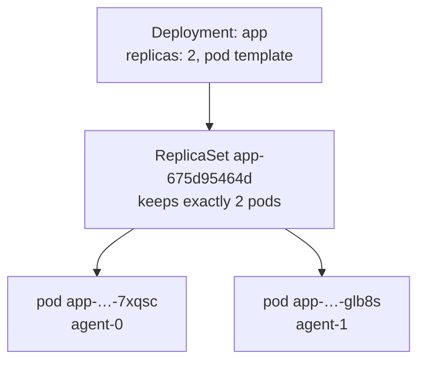
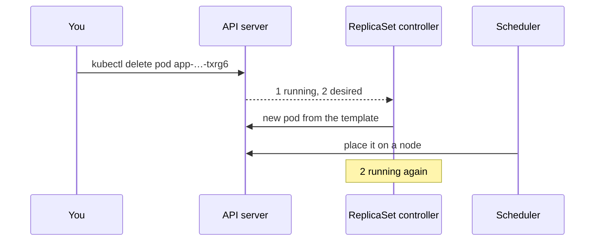
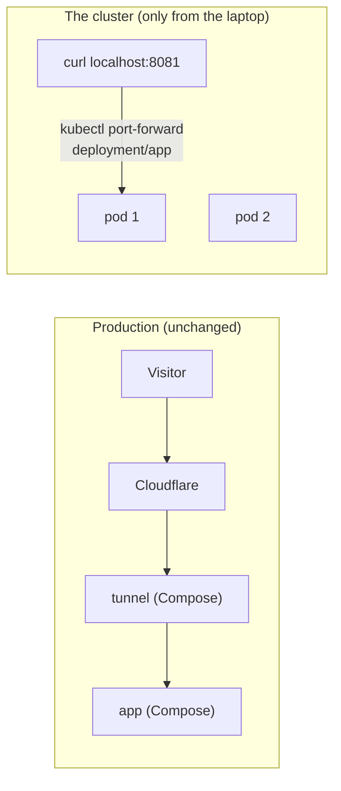

# Step 8: Keep Pods Running

[← Phase 6](README.md)

## Problem

- **A pod on its own is disposable:** a deleted pod stays deleted; nothing recreates it.
- **The same as Compose's crash problem,** now inside the cluster.

## Change

`kubernetes/app-pod.yaml` replaced by `kubernetes/app-deployment.yaml`:

```yaml
apiVersion: apps/v1
kind: Deployment
metadata:
  name: app
spec:
  replicas: 2
  selector:
    matchLabels:
      app.kubernetes.io/name: devops-lab
  template:
    metadata:
      labels:
        app.kubernetes.io/name: devops-lab
    spec:
      containers:
        - name: app
          image: ghcr.io/bende-kbb/devops-lab:sha-4c8e3c4...@sha256:181d6647...
          ports:
            - containerPort: 3000
```

- **A Deployment:** "keep N copies of this pod running." It describes a pod **template** and a number, `replicas`.
- **Labels and a selector:** each pod carries the label `app.kubernetes.io/name: devops-lab`; the Deployment counts the pods carrying it.

## How it works



- **The ReplicaSet,** created by the Deployment, counts the pods and fixes the count.
- **Pod names get random suffixes:** the pods are interchangeable copies.



- **The controller doesn't ask why** a pod disappeared; it only sees "desired 2, actual 1" and fixes the difference.

## Results

| Test | Result |
|---|---|
| First apply | 2 pods, on `server-0` and `agent-0` |
| Deleted a pod | Replaced immediately by a new pod (same node, `agent-0`) |
| Deleted the other pod | Replaced immediately, on `agent-1` |
| Deleted pods | `Terminating` → `Completed`: clean exit (graceful shutdown) |
| `curl` via `kubectl port-forward deployment/app` | `200 Hello world` |

## How users are served

**Unchanged:** visitors still reach the Compose app. In the cluster, two pods run; `port-forward` reaches one of them, from the laptop only.



## Decisions

| Decision | Why |
|---|---|
| Deployment replaces the pod manifest | A bare pod is never what's wanted once a Deployment exists |
| 2 replicas | One can disappear while the other serves |
| Label `app.kubernetes.io/name` | Kubernetes' recommended label convention |

## The analogy

See [analogy](../../explanation/analogy.md), Phase 6: the fleet manager keeping two soup trucks serving.

## Before and after

| | Before | After |
|---|---|---|
| Pods of the app | 1 | 2 |
| A deleted pod | Gone | Replaced immediately |
| Spread over nodes | One node | Several nodes |

## Limitations

- **"Running" isn't "ready":** a new pod counts as ready the moment its container starts, while the app is still initializing for 5 seconds.
- **No stable address:** each pod has its own changing IP; reaching the app still needs `port-forward`.
- **Users are still served by Compose.**

## Verify

```bash
k3d cluster start devops-lab
kubectl apply -f kubernetes/app-deployment.yaml
kubectl get deployment,replicaset,pods -o wide   # 2/2, pods on different nodes
kubectl delete pod <one pod>                     # a new one appears
kubectl port-forward deployment/app 8081:3000    # second terminal
curl -i http://localhost:8081                    # 200 Hello world
k3d cluster stop devops-lab
```