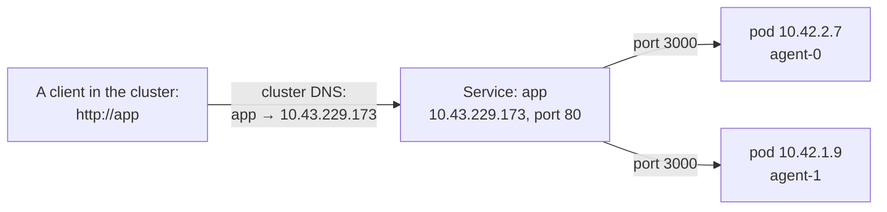
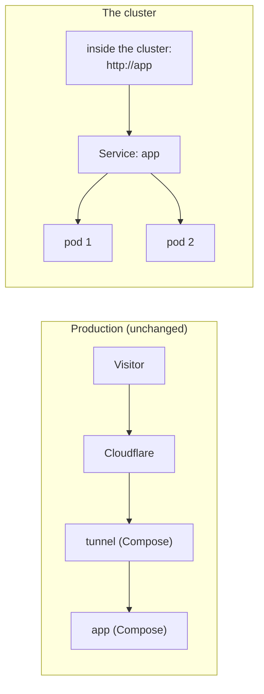

# Step 9: Reach the App at a Stable Address Inside the Cluster

[← Phase 6](README.md)

## Problem

- **Each pod has its own IP, and it changes:** replaced pods get new addresses; even a restarted pod got a new one (`10.42.2.6` → `10.42.2.7`).
- **Nothing can point at "the app":** only at one particular pod, which may be gone.
- **Two pods, but no way to use both.**

## Change

`kubernetes/app-service.yaml`:

```yaml
apiVersion: v1
kind: Service
metadata:
  name: app
spec:
  type: ClusterIP
  selector:
    app.kubernetes.io/name: devops-lab
  ports:
    - name: http
      port: 80
      targetPort: 3000
```

- **A Service:** a fixed name and address in front of a changing set of pods, found by label.
- **`ClusterIP`:** reachable only inside the cluster.
- **Port 80 → 3000:** clients use `http://app`; the Service forwards to the pods' port 3000.

## How it works



- **Cluster DNS** resolves the name `app` to the Service's IP.
- **The Service spreads requests** over the pods with the matching label.
- **An EndpointSlice** holds the Service's current list of pod addresses; Kubernetes updates it whenever pods come and go.

## How users are served

**Unchanged:** visitors still reach the Compose app. Inside the cluster, the app now has one address.



## Results

| Test | Result |
|---|---|
| `kubectl get service app` | `ClusterIP 10.43.229.173`, port `80/TCP`, no external IP |
| Endpoint list | The two pods' current IPs, port 3000 |
| `fetch('http://app')` from inside a pod | `Hello world` |
| A pod replaced | The endpoint list switched to the new pod's IP; the Service's IP stayed |
| `kubectl port-forward service/app 8081:80` + `curl` | `200 Hello world` |

## Decisions

| Decision | Why |
|---|---|
| `ClusterIP` | Nothing needs to be opened outside the cluster |
| Name `app` | The name the tunnel already uses in Compose |
| Port 80 → 3000 | The address is simply `http://app` |
| Tested from inside a pod, with Node.js's `fetch` | Tests name resolution and the Service, without a new image |

## The analogy

See [analogy](../../explanation/analogy.md), Phase 6: one phone number for "soup," ringing whichever soup truck is parked.

## Before and after

| | Before | After |
|---|---|---|
| Address of the app in the cluster | A pod's IP, changing | `http://app`, fixed |
| Pods receiving requests | One, via `port-forward` | All matching pods |
| After a pod is replaced | Old address dead | The Service follows |

## Limitations

- **New pods get traffic too early:** a pod counts as ready when its container starts, so the Service can send requests to a pod that's still initializing.
- **Reachable only inside the cluster:** users are still served by Compose.

## Verify

```bash
k3d cluster start devops-lab
kubectl apply -f kubernetes/app-service.yaml
kubectl get service app
kubectl get endpointslices -l kubernetes.io/service-name=app
kubectl exec deployment/app -- node -e "fetch('http://app').then(r => r.text()).then(t => console.log(t.trim()))"
k3d cluster stop devops-lab
```