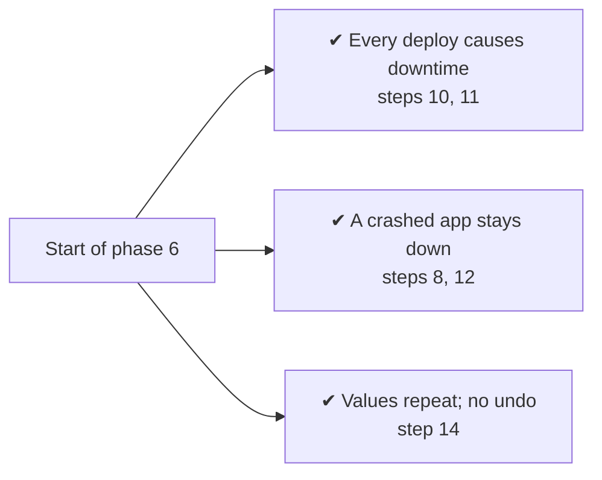
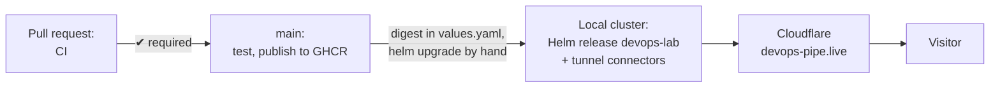

# Phase 6: Result

[← Phase 6](README.md)

## Progress

| Problem | Status | Fixed by |
|---|---|---|
| Every deploy causes downtime | ✔ Fixed | Readiness probes (step 10), rolling updates (step 11) |
| A crashed app stays down | ✔ Fixed | Deployment (step 8), production in the cluster (step 12) |
| Values repeat; no single unit, no undo | ✔ Fixed | Helm chart (step 14) |

## Measurements

| | Compose | Kubernetes |
|---|---|---|
| Failed requests during a deploy | 11 (~6 s) | 0 |
| A crashed or deleted app | Down until a person acts (~16 s) | Replaced automatically; 2 single failed requests |
| Switching production from Compose to the cluster | — | 0 failed requests |
| Handing the app over to Helm | — | 0 failed requests |

## The pipeline at the end of this phase

## New limitations introduced by this phase

| Limitation | Why it matters |
|---|---|
| Production runs only while the cluster runs | `k3d cluster stop` takes the site offline |
| The cluster uses ~1 GB of memory | Even when idle |
| The Secret is readable with the kubeconfig | Encoded, not encrypted; created by hand |
| Deleting a pod can fail single requests | The shutdown race; usual fix: a `preStop` hook |
| The tunnel is outside the chart | Two ways of managing the cluster's objects |
| k3d's helper images aren't pinned | Chosen by k3d's version |

## Open limitations, ranked

1. **Deploying means typing commands:** `helm upgrade` by hand, on the production machine.
2. **Production runs on the laptop:** all nodes share one machine; online only while it runs.
3. **Deleting a pod can fail single requests.**
4. **The image digest appears in two files,** updated by hand.
5. **Settings and Secrets are handled by hand,** outside Git.