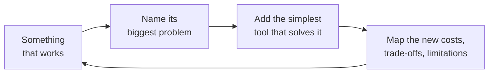
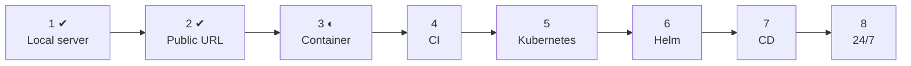
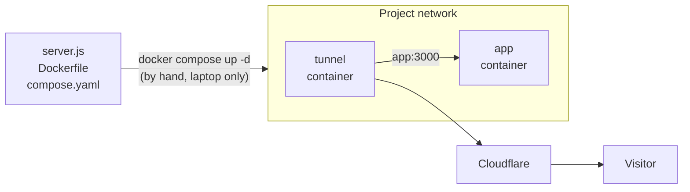

# The Pipeline: Problems, Tools, Trade-offs

**Goal:** an application that runs 24/7, safely, delivered through a guarded workflow built on industry-standard tools.

**Method:** every phase follows the same loop. No tool is added "because it's best practice"; each one has to solve a problem we can point at.

## Where we are

| Phase | Problem it solves | Tool | Status |
|---|---|---|---|
| [1](phases/phase-1-local-server/README.md) | There is no application | Node.js | ✔ Done |
| [2](phases/phase-2-public-url/README.md) | Only reachable from this laptop | Cloudflare quick tunnel | ✔ Done |
| [3](phases/phase-3-container/README.md) | Only runs where Node.js is installed; the server can reach the whole user account | Docker, Docker Compose | ◐ In progress |
| 4 | Images built by hand; nothing checks a change | GitHub Actions, GHCR | Planned |
| 5 | A crashed app stays down | Kubernetes (k3d) | Planned |
| 6 | Every new version means hand-editing deployment files | Helm | Planned |
| 7 | Deploying is a manual command | Argo CD | Planned |
| 8 | Offline when the laptop sleeps; random URL | Cloud cluster | Planned |

## The pipeline so far

## Phase summaries

### 1 · Local server
**Problem:** a pipeline needs something to deliver. **Solution:** the smallest HTTP server, plain JavaScript, no dependencies. **Cost:** almost none. **New limitations:** reachable only from the laptop; mistakes crash the server at runtime.

### 2 · Public URL (walking skeleton)
**Problem:** nobody outside the laptop can reach the app. **Solution:** a Cloudflare quick tunnel; the laptop opens a connection *out*, visitors' requests come back through it. **Cost:** the server is exposed to the internet; Cloudflare decrypts the traffic; a vulnerability would run with the laptop user's full access. **New limitations:** random URL, two terminals, offline when the laptop sleeps.

### 3 · Container (in progress)
**Problem:** the app only runs where Node.js is installed, and runs with the user's full permissions. **Solution:** package app + runtime into an image; run it as an isolated container, configured in `compose.yaml`. **Cost:** a new root-level service (Docker Engine), a ~1 GB naive image, new concepts, weaker isolation than a virtual machine.

### 4–8 (planned)

| Phase | Problem | Tool | Trade-off to expect |
|---|---|---|---|
| 4 | Images built by hand; broken changes can be merged | GitHub Actions, GHCR | Pipeline code to maintain; CI gets access to the registry |
| 5 | A crashed app stays down | Kubernetes (k3d) | Many new concepts for one small app |
| 6 | Hand-editing manifests for every version | Helm | A templating language on top of YAML |
| 7 | Deploying is a manual command | Argo CD | Another system in the cluster; Git becomes the only way to change production |
| 8 | Offline when the laptop sleeps | Cloud cluster | Free-tier limits; real secrets appear |
