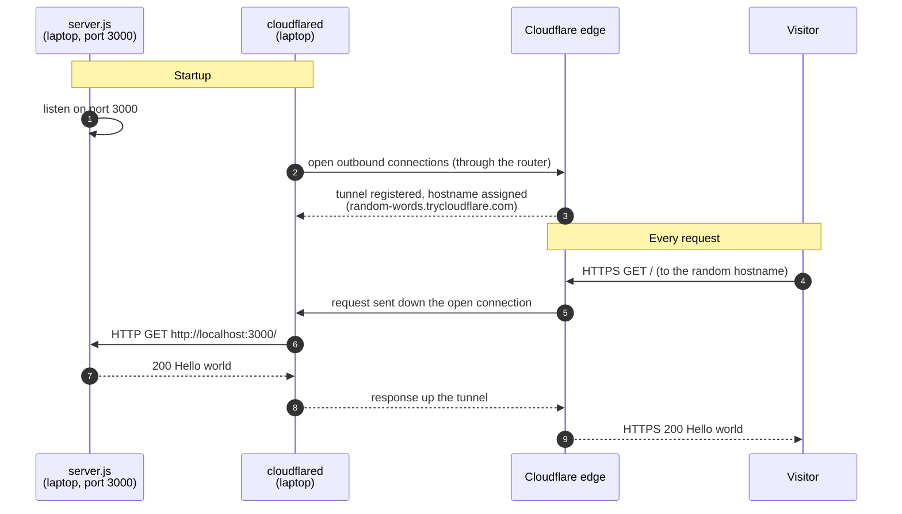
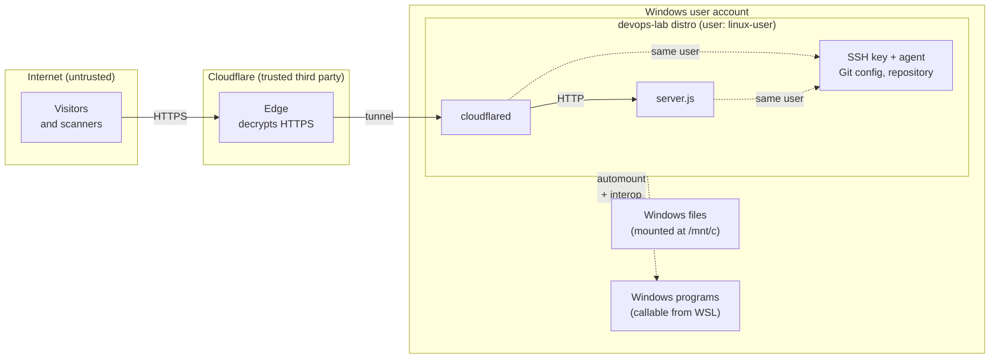

# Spike DL-9: Exposing a Local Server Through a Cloudflare Quick Tunnel

| | |
|---|---|
| **Question** | How can a server on a laptop behind a home router be reached from the internet without opening router ports? What exactly is exposed, and what are the risks? |
| **Time box** | 45 minutes |
| **Outcome** | Adopt the quick tunnel for the walking skeleton, with the risks below accepted for a hello world server only. |

---

## How it works

### The key idea: the connection goes out, not in

A home router blocks connections that start on the internet and try to come **in**. It allows connections that start inside and go **out**; that's how every browser works. `cloudflared` uses this: at startup it opens connections **out** to Cloudflare and keeps them open. Visitors' requests later travel back down those already-open connections. Nothing ever has to come in through the router.



Two points that are easy to get wrong:

- **Cloudflare never contacts `localhost:3000`.** `localhost` means "this machine", and Cloudflare's servers are not this machine. `cloudflared`, running on the laptop, makes that request, exactly like `curl` would.
- **The tunnel exists before any visitor arrives.** Cloudflare doesn't "find" the laptop when a request comes in; it uses a connection the laptop opened earlier.

### The command

```bash
cloudflared tunnel --url http://localhost:3000
```

| Part | Meaning |
|---|---|
| `cloudflared` | A compiled program (written in Go), installed from Cloudflare's official GitHub release as a `.deb` package |
| `tunnel` | Subcommand for creating and running tunnels |
| `--url http://localhost:3000` | The **origin**: where `cloudflared` forwards every request it receives |
| (no account, no credentials) | Creates a **quick tunnel**: a temporary tunnel with a random hostname from Cloudflare's TryCloudflare service |

`cloudflared` usually opens four connections, to more than one Cloudflare data center, so the tunnel survives one connection failing. Stopping `cloudflared` deletes the tunnel and its hostname; every restart produces a new URL.

---

## Experiments and findings

| Experiment | Result | Explanation |
|---|---|---|
| Open the URL from a phone on mobile data | `Hello world` | Reachable from another network; nothing opened on the router |
| `curl -i` the public URL | `HTTP/2 200`, extra headers (below) | Cloudflare sits between visitor and server |
| Stop `server.js`, keep the tunnel | `502 Bad Gateway` | The tunnel works, but `cloudflared` cannot reach `localhost:3000`. "Gateway" = the middleman, which is up; what's behind it is not. |
| Stop the tunnel | Cloudflare tunnel error | The edge knows the hostname, but no connector is attached |
| Restart the tunnel | New random URL | Quick tunnels are temporary by design |

### Headers added or changed by Cloudflare

| Header | Meaning |
|---|---|
| `HTTP/2` (status line) | The visitor speaks HTTP/2 to Cloudflare; the server still speaks HTTP/1.1 to `cloudflared`. Cloudflare translates. |
| `Connection`, `Keep-Alive` removed | "Hop-by-hop" headers: they describe one connection only, so proxies don't forward them |
| `cf-ray: <id>-LIS` | Unique request ID; the suffix is the data center that handled it (here Lisbon) |
| `cf-cache-status: DYNAMIC` | Cloudflare did not cache the response |
| `server: cloudflare` | Replaces the origin's server identity |
| `x-robots-tag: none` | Tells search engines not to index the page |

### Installation

`cloudflared` 2026.10.1 was installed from the official GitHub release `.deb`, with its SHA-256 checksum verified against the release notes. **Cooldown exception:** the release was 13 days old (rule: 14). Accepted for the spike; the Task runs after the cooldown has passed.

---

## Risks

### Trust boundaries

Every arrow that crosses a boundary in this diagram is a place where something outside our control touches something inside it.



### What can go wrong

**1. The server is exposed to the whole internet.**
Anyone who has the URL can send `server.js` any request, and automated scanners constantly probe new hostnames. Node's HTTP parser and our handler code are now the attack surface. For a server that returns a fixed string, there is nothing to steal and very little to break, which is exactly why only this server is exposed. Every future feature that reads input (paths, query strings, request bodies) widens this surface, so input handling becomes a security question from that point on.

**2. Denial of service: the server can be overwhelmed.**
A flood of requests can exhaust the laptop's CPU, memory, or home bandwidth, and slow down everything else running on it. Cloudflare's network absorbs some attack traffic at the edge, but requests that look legitimate are forwarded through the tunnel to the laptop. There is no rate limiting, and if the process crashes, nothing restarts it: the site stays down until someone notices. Impact here is limited to availability and a slow laptop; no data is at risk.

**3. A vulnerability in `cloudflared` or in Node.js: code execution on the laptop.**
This is the most serious risk, and its impact is larger than it first looks. Both programs run as the **Linux user** in the `devops-lab` distro. An attacker who could execute code through either of them would act as that user, and could:

- read and modify the repository, and push changes to GitHub **if the SSH agent currently holds the unlocked key** (the agent serves any process of the same user);
- read everything in the Linux home folder, including Git configuration and shell history;
- read and write **Windows files** under `/mnt/c`, with the Windows user's permissions, because WSL mounts the Windows drives automatically;
- **start Windows programs** (for example `powershell.exe`), because WSL interop is enabled by default.

In other words: **the dedicated distro isolates configuration, not security.** It prevents accidents (wrong Git identity, wrong cluster), but it is not a wall against an attacker who already runs code inside it. This risk is low-likelihood for a tiny, verified, pinned program and a server with no input handling, but its impact is high.

**4. Cloudflare can read and change all traffic.**
HTTPS ends at Cloudflare's edge, so Cloudflare sees every request and response in plain text, and could modify them before they reach the visitor. It also sees visitors' IP addresses. This is a trust decision, not an attack: we rely on Cloudflare's policies and reputation. For a public hello world, nothing confidential flows through it. It becomes relevant as soon as the application handles anything private.

**5. A random URL is not access control.**
The hostname is hard to guess, but anyone who learns it (from a shared link, a screenshot, browser history) can use it. Obscurity can delay discovery; it never protects anything.

**6. Abuse of the hostname.**
Free tunnel hostnames are a known tool for attackers hosting phishing pages and malware, because they look legitimate and cost nothing. If the laptop were compromised through risk 3, the same tunnel could serve malicious content under a Cloudflare hostname. Some security filters also distrust `trycloudflare.com` links for this reason.

**7. Visitor data.**
Requests arrive with the visitor's IP address (Cloudflare forwards it in a header). Logging requests would mean collecting personal data, which carries legal obligations (for example under GDPR in the EU). The server currently logs nothing.

### Not a risk

- **No router ports are opened**, and the home IP address is never published: visitors only ever see Cloudflare.
- **Only the named origin is reachable.** Other services on the laptop (say, on port 8080) cannot be reached through the tunnel.

### Summary

| # | Risk | Impact | Likelihood now | Accepted because | Mitigation (later) |
|---|---|---|---|---|---|
| 1 | Server exposed to the internet | Low (fixed response) | Certain | Nothing to protect | Input validation when features arrive |
| 2 | Denial of service | Availability, slow laptop | Low | Hello world, no SLA | Rate limiting, restarts, hosting off the laptop |
| 3 | Code execution via cloudflared/Node | **High** (repo, SSH agent, Windows files) | Low | Verified, pinned, minimal code | Containers; disable WSL automount/interop for this distro; don't leave the SSH key loaded |
| 4 | Cloudflare reads/modifies traffic | Confidentiality | Policy-dependent | No private data | Revisit before handling private data |
| 5 | URL is not access control | Unwanted visitors | Certain | Content is public anyway | Real authentication if ever needed |
| 6 | Hostname abused after compromise | Reputation, visitors harmed | Very low | Follows from 3 | Same as 3 |
| 7 | Visitor IPs | Legal (personal data) | None (no logging) | Nothing is stored | Decide deliberately before adding logs |

---

## Decision

Adopt the quick tunnel for the walking skeleton, exposing only the hello world server. The risks above are accepted for this content only. Risk 3 is the one to reduce first; containers (next phase) are the main step towards that.
